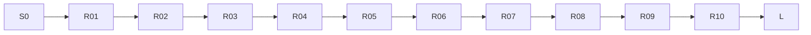

# revkit development plan

Status: approved scope for planning and repository bootstrap only. Nothing below authorizes execution, spend, a release, or an announcement. This is a rolling-wave plan: only S0 is detailed now.

## 1. Product contract

- **User:** developers and small teams reviewing agent-written changes before push.
- **Workflow:** preview a committed change → run an independent review using an approved runtime → inspect anchored findings and coverage → the author's agent proves, repairs or requests a waiver → CI verifies the exact-head receipt without a model call.
- **Demonstration:** a developer can follow that loop from a terminal; incomplete work and unresolved findings cannot masquerade as a passing gate. The first shipped contribution is the preview-to-findings workflow on one certified subscription runtime.
- **Non-goals:** feature-for-feature imitation, automatic patch application by the reviewer, hosted service, daemon, database, editor extension, web viewer, universal provider catalog or multi-forge rollout. SARIF and later static HTML cover portable display. Review quality and usable workflow are the parity targets, not interface compatibility.
- **Architecture:** one Rust CLI, plain versioned append-only records in the Git common directory, a bounded read-only evidence interface and deterministic bookkeeping around probabilistic judgment. No new hosted credentials are needed for offline verification.

### Invariants by consumer

| Consumer | Invariant |
|---|---|
| Preview and scope (0.1+) | Resolve range endpoints to immutable objects; single commit uses first parent or empty tree for true root. Missing required history is an error, not an empty change. `plan` makes no model calls, runs no checks and writes no session; show scope, exclusion reasons, tier, units, trusted-rule origin and size, checks to be run and estimated admission. Tests, docs and config are in scope by default. Checks-only tier skips are not reviewed files. Relevance and disclosure are independent; context cannot bypass denied-path policy. Never follow symlinks or descend into gitlinks. Load repository rules and policy from trusted base; all matching rules apply unless explicitly replaced within trust limits. Reject collisions and over-limit rule sets rather than silently truncating. |
| Runtime and budget (0.1+) | Certify version, platform, auth mode and channel. Use per-run gateway attachment or a separately certified, filtered read-only projection and typed final message; no persistent changes or silent downgrade. Deny ambient tools, config, shell, writes and unauthorized reads/egress. Separate input/generation limits, admission reservations, observed usage, subscription quota and equivalent API prices. Reserve each stage before dispatch, bound time/output/attempts and observable turns, settle once, account for unknown usage conservatively and report it as unknown. Grace settlement is separately reserved and read-free where enforceable. Exhaustion and overshoot cannot pass. Record stage, attempt/request visibility, context/response sizes, usage provenance and terminal reason; a tool call is not a provider request. |
| Reports and CLI (0.1+) | One expected terminal verdict per assigned file per required discovery pass plus explicit successful completion; no finding and no verdict are different. Preserve usable findings on partial failure. Anchor to real bytes on a named immutable comparison side; retain only unique verified recovery, with corrections recorded. Unanchored leads are local, nonblocking and never inline. Stable IDs separate identity from output ordering. Noninteractive `revkit <command>`; text or versioned JSON, exactly one JSON result on stdout including failures, progress on stderr. Use explicit error codes: 0 pass, 1 invalid request/config or internal failure, 2 blocking findings, 3 incomplete execution/coverage, 4 missing/stale receipt, 5 missing/failed check, 6 unavailable reviewer. Report all applicable reasons separately from terminal health and severity. |
| Receipts, lifecycle and resume (0.3+) | Bind portable receipts to exact head, comparison snapshots, trusted policy and resolved inputs, check/proof digests and per-file producer/settlement. CI checks scope, coverage and evidence without a model. No raw traces or excerpts in the receipt. Patch-id alone cannot authorize a restamp. A later covered absence differs from a skipped/unsettled file; neither is repair. Require before-failure/after-pass reproducing the original issue, or vetted repair diff and a cited finding check proving why its trigger no longer has the impact. Bind to snapshots and reopen if no longer applicable. Authorized waivers carry reasons. A citation that exists is not enough for suppression; P0/P1 require mechanical contradiction or authorized human disposition. Keep an audit trail. Root-cause grouping changes display only. Resume only atomically completed work with identical effective input and original producer; changed input starts fresh. Synthetic workspace heads never pass committed-head verification. |
| Change isolation and publication | Grouping assigns files; investigation planning offers hints within a fixed unit; discovery finds defects. Validate membership exactly once; deterministic fallback for invalid experimental proposals. Start with direct discovery, not automatic planning or compaction. Treat repository and model output as untrusted data. Keep optional raw debug material private, bounded and expiring; audit exports. Separate code/check execution, model access, offline verification and privileged posting. Never run untrusted PR code with publisher credentials. |

## 2. Decisions and gaps

> **DECISION:** Rust, public repository, CLI only, Apache-2.0. Use independent implementation and rights-cleared inputs; third-party dependencies, test data, demo material and redistributed assets still need a notices/rights audit.

> **GAP — bootstrap / distribution:** Confirm the GitHub owner and creation rights before creating the remote. Separately confirm registry/tap names, availability, publisher access, supported target/channel cells and release owner before each dependent publication. The GitHub name does not reserve a package name.

> **GAP — live evidence:** Approve harness version/OS, auth and terms, provider/data scope and bounded usage before any live probe. Approve corpus access, model/judge and spend before live replay, API validation or a live demo. Offline mechanics can proceed on execution authorization; unavailable, help-only and stub-only results never certify live use.

> **GAP — signing:** Name the release signer/custodian, trust root, verification instructions and rotation/revocation procedure before signed 1.0 preparation. Receipt signing uses a separate trust decision at 0.8.

## 3. Active wave

### S0 — Harness capability spike (unshipped)

**Outcome:** an operator can select a versioned, confined subscription runtime/channel for 0.1 or make a reproducible NO-GO decision before Rust work depends on it.

**Depends on:** no delivery predecessor. Start only on owner authorization after the bootstrap. Use disposable synthetic Git fixtures with inert canaries. Exact binaries, versions, platforms, auth and probe authority are inputs to each live lane, not inferred prerequisites satisfied by help. Missing auth, tools or approval yields a recorded reason and no live probe.

**Scope / non-goals:** for omp, Claude Code, Codex and agy, try the least-privilege per-invocation attachment path where permitted; evaluate a filtered projection and typed final-message fallback only when attachment cannot be certified. Do not build the Rust CLI, implement an adapter, probe a comparison tool, run replay, change persistent settings, use real code or ship anything. Record exact redacted invocation/setup and expected observations rather than raw transcripts. Help, scripted, and authorized actual-auth observations must be separate evidence classes.

#### S0 acceptance

- Done when an operator can read a versioned matrix covering omp, Claude Code, Codex and agy and see an attach, fallback or refusal decision for each, with version/platform/auth/channel, evidence class and explicit unavailable or uncertified reasons where applicable.
- Done when an operator can reproduce authorized cases with sanitized fixtures or exact safe steps and see typed success with per-file settlement and a validated anchor, plus explicit failure for omitted verdict, forbidden access and bounded no-progress/timeout cleanup, with observed model/usage or explicit unknowns.
- Done when an operator can read a first-runtime GO naming one tested version/platform/subscription/channel that passed every required case under actual approved authentication, or a NO-GO naming missing evidence and the smallest safe next decision. Offline-only, unrun or failed cases cannot yield GO.

**Verification** (S0 creates these artifacts and commands; none exist in the bootstrap):

1. `python3 spike/check_matrix.py --self-test` → exit 0 only if a complete GO fixture validates and help-only, stub-only, evidence-missing or unavailable GO fixtures are rejected. NO-GO with stated gaps is valid. Validate decisions, not schema shape alone.
2. `python3 spike/check_matrix.py spike/capabilities.v1.json` → exit 0 for a consistent GO **or** NO-GO record. Exit 0 is record validation, not certification. Follow each selected lane's recorded fixture commands and expected results. For a GO, the authorized actual-auth lane must read the allowed pinned input, report and correct a bad anchor, settle every file and return valid data; show that bare finish/missing verdict is incomplete. Denial and cleanup canaries must demonstrate no ambient config/tool loading, no unauthorized read, write or egress, no persistent settings change, and no surviving process. Record usage visibility, local deadlines, bounded output and the basis of spend/term approval without exposing credentials. If a required observation cannot be made, record a non-pass and its reason; do not simulate success. Stop probing each lane at a pass, evidenced failure or unavailable prerequisite within the approved limits.

For denial cases, verify the canary is reachable to the test observer, and that the attempted operation reaches the actual confinement boundary and is denied. A model declining or failing to attempt an operation proves nothing about containment. Exercise the deadline against a supervised process and its descendants, not a fabricated matrix result.

**PR shape:** one cohesive evidence-only PR (matrix, checker, rights-cleared fixtures or reproduction instructions). Review the evidence against what 0.1 will rely on. If any real trace is sensitive, retain it outside Git and publish only a reviewed sanitized observation; no forbidden data in fixtures.

**Containment:** no persistent setup edits. Use scratch fixture roots, allowlisted data/transport and a supervisor watchdog; stop the lane and isolate suspected leakage, retain only authorized sanitized evidence. Remove the disposable state after cleanup. A NO-GO closes the spike report, not the runtime gate: 0.1 stays unready until owner-approved requalification or replanning.

## 4. Roadmap and release conditions

**Daily-use gate:** Before starting each release after 0.1, show the preceding version in routine use on at least one repository on five consecutive active development days with eligible changes. Record sanitized date, released version, real run outcome and where it informed the operator's workflow, plus operator confirmation. Demos, fixtures and installation counts do not count. No adoption is established. At 0.5, no use beyond the author pauses further product/channel commitments for an explicit personal-tool versus product decision.

| Milestone | User-visible outcome | Depends on | Unresolved release conditions |
|---|---|---|---|
| S0 / spike | Choose a demonstrated runtime path or decline to build against one. Not shipped. | Bootstrap and execution authority | Auth/terms/data/bounds before each live lane; select first runtime only on GO. |
| R01 / 0.1 Review | In a real Git checkout, `init`, inspect `doctor`, `plan --base main`, then `review --base main` (or `--commit`); get text/JSON/SARIF anchored findings and look up a finding or its effective rules. Clean, finding-bearing, incomplete and no-runtime runs are distinct. One admitted unit; no scaffold release. | S0 landed evidence and GO for selected tuple | Confirm target and install route. R01 creates Cargo workspace/lock, offline scripted reviewer, fixture CLI contract and CI checks (`cargo fmt --check`, `cargo clippy`, `cargo check`, `cargo test`); these are planned, not gates that exist today. Validate the real CLI workflow against the selected certified runtime with approved inputs. |
| R02 / 0.2 Replay | Compare review on first-reviewed commits from the user's own merged PRs and on a pinned public benchmark; import reference findings, see usage and calibrate packs. | R01 + daily-use evidence | Corpus rights, reproducible matching and any model/judge spend. A report can find below-bar or not-comparable; neither is a parity claim. |
| R03 / 0.3 Receipt | Attach and render a machine-verifiable exact-head receipt and gate a PR with offline `verify`. Restamp only on proven evidence equivalence. | R02 + daily-use evidence | Validate notes/PR transport, trusted base policy/rules and replayed settlement against current head. No credential-bearing verification. |
| R04 / 0.4 Loop | Run challenge, proof/waiver, presentational grouping and up to three repair rounds through a pre-push skill; compare lifecycle across rounds and expire debug data. | R03 + daily-use evidence | Calibrate adjudication and protect high severities; no independent-family claim where unavailable. Validate stale proof and absence handling. |
| R05 / 0.5 Runtimes | Choose any of the four certified harnesses and request independent profiles or a two-family panel. | R04 + daily-use evidence | Each target tuple needs its own certification; no inference from help, another version or another platform. Panel default needs incremental-yield evidence. Apply 0.5 product checkpoint. |
| R06 / 0.6 Large changes | Review larger changes across units under bounded budgets, inspect integration, resume exact compatible work, review uncommitted changes and scan whole files. | R05 + daily-use evidence | Replay-informed split and context thresholds, incomplete-coverage/failure checks and resume provenance. Single-repo scope; oversized inputs still report explicit partial/unsupported outcomes. |
| R07 / 0.7 CI | Review in CI with an API key, collect structured output and publish stable, current-head GitHub inline/summary results. Target workflow parity, not all forge/provider features. | R06 + daily-use evidence | Wire conformance for OpenAI-compatible Chat Completions and Anthropic Messages; approved runtime spend/secrets, unprivileged review vs privileged posting, update identity and fork policy. |
| R08 / 0.8 One ledger | Triage human/forge and SARIF findings through the same lifecycle; use optional SSH receipt signatures for a team trust policy. | R07 + daily-use evidence | Source access, provenance and safe import; signer allowlist/rotation semantics for receipt signing. |
| R09 / 0.9 Calibration | Inspect outcome stats, accept reviewed proposed rule changes and export a static report. | R08 + daily-use evidence | Sufficient labelled outcomes for the proposal in question; no automatic suppression, no raw transcript export. |
| R10 / signed 1.0 | Install an authenticated build and depend on stable CLI/exit meanings and frozen v1 receipt, finding and policy contracts. | R09 + daily-use evidence | Approved targets/channels, publisher rights, trust root and signed-artifact verified installs; old-record/CLI compatibility gates pass. |
| L / public launch | Follow a verified quickstart and reproduce a demo against the actual release. | R10 published and verified | Verified links and install/run, rights-cleared reproducible demo, release notes, support matrix, defensible quality/cost claims or omit them, explicit announcement approval. |

### Replay and replanning

Register corpus/rights, exact first-review base/head, rules, scope, reference labels, model identity, runtime/protocol, effort/budget, fresh-run requirement, evaluator/judge revision, adjudication method and tolerances before the comparison. Later fixes supply labels only; historical comments are not ground truth. Count each accepted reference once; uncovered references are misses in end-to-end recall. Report evaluated and missing inputs, class-specific misses, verified unique novel causes and sampled confirmation with denominators, grouping burden, wrong suppressions, coverage, requests/usage source and latency. Stub runs establish mechanics only; published benchmark figures without a matching dataset/model/protocol/judge/evaluator are descriptive, not a parity pass. Keep private replay inputs and claims out of public artifacts unless separately rights-cleared.

Approve a minimum acceptable recall and confirmation rate and maximum burden before viewing scored results. Keep those thresholds and the missing-instance policy fixed across arms. Blind adjudication to the arm where feasible; label a tuned-on corpus as calibration, not independent evidence. Use untouched, rights-cleared evaluation data for any public generalization claim.

| Change one variable at matched inputs | Decision metric and affected work |
|---|---|
| Single unit vs local affinity packing vs metadata-only grouping; then integration on/off with fixed units | Cross-file accepted-reference retention and admission failure at comparable task size, coverage, requests and time. If two or more cohort changes cannot be admitted as single units, or integration recovers material misses without coverage regression, propose bringing that part of R06 forward. |
| Direct vs tool-free investigation brief; separately one vs extra fresh discovery round | Incremental verified causes or recovered references per extra request/elapsed time, no severe recall loss or duplicate-driven burden. Revisit R01 effort or R06 defaults only with evidence. |
| Checks-only vs the same checks plus model on the same eligible doc/test changes | Revisit the low-tier default if repeated material misses justify incremental usage. Tests remain in scope. |
| Deterministic anchor feedback vs one bounded repair; separately audit-only vs suppression on fixed candidates | Unique verified recoveries and zero wrong inline locations; tighten R04 on any wrong high-severity removal. Keep the other stage fixed. |
| Certified subscription lane vs direct API on matched inputs/protocol/model where isolatable | A material recall gap or measurable overhead savings at preserved coverage/quality can bring R07 runtime work forward. If neither fixes detection, consider early R08 intake. If S0 has no viable subscription tuple, pause R01 and propose API-first rather than bypass confinement. |

Experimental arms can use isolated evaluators without shipping the later product surface. Predeclare material-effect and quota/cost/latency bounds with the owner; if evidence is non-comparable, do not change sequencing on its authority. Any reordered milestone must rebind dependencies and the predecessor adoption gate in the approved plan before a prompt is activated.

## 5. Later execution rules

- `milestone-runner` starts only on owner authorization. Reconstruct state from merged code, open PRs, actual checks and current evidence; resume exact work instead of cloning it. Run one design check for the active slice. Only materialize a `/goal` after dependencies merge or evidence lands and applicable owner gates clear; routine detail belongs in the first implementation PR. Changes to outcomes or acceptance require owner approval.
- Default to one cohesive Conventional Commit PR. Use `stacked-prs` only for a justified shallow dependency stack: prove ancestry, parent bases and slice identity, detect native membership and delegate parent-first landing. Use `pr-swarm` only for two or more already-open, dependency-free, file-disjoint PRs in isolated worktrees. Readiness is not authority to enroll, merge or delete anything.
- Use `pr-review` for one substantive review per PR and one cumulative integration check per stack. Re-review changed work and affected contracts only. Escalate after three unsuccessful fix rounds; never merge known blockers to meet that cap. Do not solicit or tag external reviewer bots.
- `ship-workflow` owns authorized PR publication, current-head/current-base or actual queue-candidate CI, required reviews and landing, post-merge acceptance and proof-based cleanup. Explicitly advisory checks are reported separately; unclassified failures remain blocking. A green branch push isn't integration evidence. Stop dependents after a failed mainline check and contain with an authorized revert or focused reviewed repair. Preserve unresolved worktrees.

## 6. Release and launch playbook

**Release source/owner.** R01 establishes the Cargo package version as version truth, a synchronized `Cargo.lock`, and `CHANGELOG.md` as user-facing change history. After the last milestone for a version lands and passes acceptance, the named release owner prepares one release PR against `main` with version/lock, notes, compatibility/matrix evidence and artifact build inputs. Package wrappers and manifests derive the same version; no parallel sources. Use `ship-workflow` and normal required checks and review. Tag the exact reviewed release commit only with separate approval; verify it before building/publishing. Tagging, GitHub Releases, each package channel and announcements need separate owner authorization.

**Distribution matrix.** Candidate initial targets from the design: macOS arm64 (local) and Linux x86_64 (developer/CI). No target/channel is certified by this plan; the release owner records target triples, OS/runtime minimums, artifacts and checks for each approved cell. Windows/other architectures and additional package platforms are not commitments.

| Channel | macOS arm64 | Linux x86_64 | Clean-install proof in an isolated environment |
|---|---|---|---|
| GitHub Release archive | Candidate | Candidate | Download archived binary, verify digest/signature as applicable, extract and run; no developer checkout or PATH shadow. |
| Homebrew tap | Candidate | Not proposed initially | Install exact approved formula from tap; verify selected archive/checksum and run. |
| crates.io / `cargo install` | Candidate | Candidate | `cargo install --locked revkit --version "$VERSION"` from the approved registry; verify resulting version and behavior. |
| npm binary wrapper | Candidate | Candidate | `npx --yes "revkit@$VERSION" --version`; confirm target selection and verified payload, then run workflow through the same wrapper. |
| PyPI binary wheel / `uvx` | Candidate | Candidate | `uvx "revkit==$VERSION" --version`; confirm the published wheel/target and run workflow through the same entry point. |

**Candidate checks.** Build from the intended release commit with locked dependencies; run required Rust validation and rights/security audit. In clean target environments, verify version/help, run a committed fixture `plan`, then exercise the shipped review with a certified approved lane or deterministic fixture as appropriate (label which), and from 0.3 verify a current receipt offline and reject a changed head/partial result. For 1.0 run old supported CLI/result fixtures and verify v1 finding/receipt/policy records from prior versions plus explicit rejection of incompatible versions; no silent field or exit-code repurposing. Fail an advertised cell if its actual installer is broken. Before publication test local/staged artifacts; after publication rerun through the real endpoints to catch packaging differences. Do not broaden support on the strength of a cross-build alone.

Freeze the candidate digests before approval. Promote the exact smoke-tested bytes; a rebuild or repack with different bytes is a new candidate and invalidates affected smoke/signing evidence.

**Integrity and incident response.** Compute SHA-256 for exact assets and packages. For signed 1.0 authenticate the release tag and checksum manifest with the approved trust root, then check every retrieved artifact against the signed manifest and verify wrappers fetch the pinned target digest. Record artifact name/target, digest, signing identity, test observations and exact commit. On missing/invalid signature, digest mismatch, incompatible install or bad payload: stop further publication, disable/yank affected downloads where supported, mark any live release unsafe, communicate affected versions/checksums with owner approval, and point users to the last verified build. Investigate, revoke/rotate signing material if compromised, and publish a reviewed patch with new version and digests. Do not silently replace bytes under the same version.

**Launch gate (not a release synonym).** Verify install and run from the public quickstart on the advertised channels; reproduce an end-to-end demo on rights-cleared inputs; publish release notes and known limits. Link evidence for any public quality, cost or comparability claim (run card, denominator, coverage, estimate versus observed usage); omit unsupported claims. Signed 1.0 is technical readiness, not authorization to announce. Obtain separate owner approval on launch text, channels and timing.
